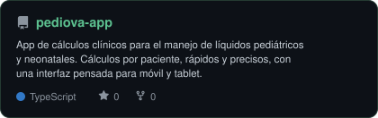
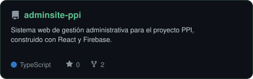
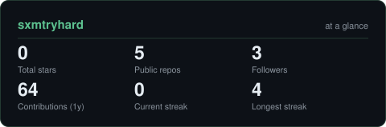
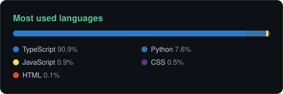

<!-- BANNER - terminal profile.sh --live. Generated by scripts/banner/generate.py. -->
<picture>
  <source media="(prefers-color-scheme: dark)"  srcset="assets/banner-dark.svg">
  <source media="(prefers-color-scheme: light)" srcset="assets/banner-light.svg">
  
</picture>

 

<!-- NAME / TAGLINE - animated typing -->

 

<!-- SOCIALS -->
&nbsp;&nbsp;

 

---

## Sobre mí

Hola, soy **Samuel**, estudiante de **Ingeniería de Software** con enfoque en desarrollo full-stack.

- 🎓 Estudiando **Ingeniería de Software** y construyendo proyectos reales mientras aprendo.
- 🛠️ Trabajo en frontend con **React** y en backend con **Java + Spring Boot** y **Python**.
- 🎥 Tengo un canal de YouTube: **[@sxmuuuu](https://www.youtube.com/@sxmuuuu)**.
- 🐧 Me gusta trabajar en **Linux** y entender cómo funcionan las cosas por dentro.
- 🌎 Hablo **español** (nativo) e **inglés** (B2).

 

## Stack

---

## Skills

<table>
<tr>
<td width="50%" align="center" valign="middle">

<!-- Self-rated stack radar - edit assets/skills.json, the workflow redraws it -->
<picture>
  <source media="(prefers-color-scheme: dark)"  srcset="assets/radar-dark.svg">
  <source media="(prefers-color-scheme: light)" srcset="assets/radar-light.svg">
  
</picture>

</td>
<td width="50%" align="center" valign="middle">

<!-- Self-rated areas radar - edit assets/areas.json, the workflow redraws it -->
<picture>
  <source media="(prefers-color-scheme: dark)"  srcset="assets/radar-areas-dark.svg">
  <source media="(prefers-color-scheme: light)" srcset="assets/radar-areas-light.svg">
  
</picture>

</td>
</tr>
</table>

---

## Proyectos

<!-- Edit assets/projects.json to change which repos appear here -->
<a href="https://github.com/sxmtryhard/pediova-app">
  <picture>
    <source media="(prefers-color-scheme: dark)"  srcset="assets/card-pediova-app-dark.svg">
    <source media="(prefers-color-scheme: light)" srcset="assets/card-pediova-app-light.svg">
    
  </picture>
</a>
<a href="https://github.com/sxmtryhard/adminsite-ppi">
  <picture>
    <source media="(prefers-color-scheme: dark)"  srcset="assets/card-adminsite-ppi-dark.svg">
    <source media="(prefers-color-scheme: light)" srcset="assets/card-adminsite-ppi-light.svg">
    
  </picture>
</a>

---

## GitHub en números

<!-- Generated by scripts/cards.py into this repo, refreshed daily by the workflow -->
<picture>
  <source media="(prefers-color-scheme: dark)"  srcset="assets/card-stats-dark.svg">
  <source media="(prefers-color-scheme: light)" srcset="assets/card-stats-light.svg">
  
</picture>

 

<picture>
  <source media="(prefers-color-scheme: dark)"  srcset="assets/card-langs-dark.svg">
  <source media="(prefers-color-scheme: light)" srcset="assets/card-langs-light.svg">
  
</picture>

---

` built with curiosity · @sxmtryhard `

